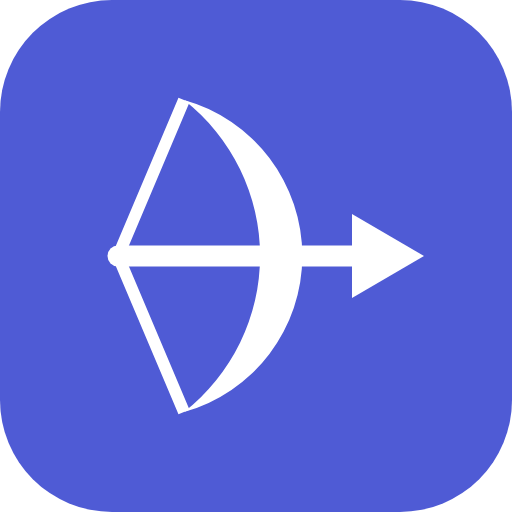

<p align="center"></p>

<h1 align="center">Artemis</h1>

**An open-source AI agent that lives on your computer.** It reads your files, runs your commands, browses the web and remembers what you tell it. You pick the model. You keep the data. You press approve.

[](LICENSE)


<!-- IMAGE: main window with a chat, the sidebar and the side panel open. File: docs/images/hero.png (about 1800x1100) -->
<p align="center"></p>

Artemis is a desktop app built with **Electron + React + Vite**. It is independent and not affiliated with Anthropic or any other model provider. There is no built-in default provider: you add your own in Settings, and any server that speaks the OpenAI API (`/v1/chat/completions`, streaming and tool calling) works.

## What is Artemis?

It is not a chat window glued to one API, and it is not a copilot stuck inside an editor. Artemis works in your files, your terminal and its own browser. It remembers what it learns, it asks before it acts, and it runs with any model, cloud or local.

Chats, notes and memory are plain files on your disk. Every line of code is open: fork it, break it, fix it.

## Highlights

- **Agent that does the work**: reads, writes, edits, moves and deletes project files; searches and fetches the web. File tools stay inside the project folder and ask before changes.
- **Office files**: reads and writes Excel, CSV and ODS (formulas included); reads Word and PDF.
- **Computer control (macOS)**: screenshots, mouse and keyboard, with one shortcut to stop.
- **Integrated browser** with its own saved logins, driven by the agent.
- **Terminal**: runs commands in your real shell and reads an integrated terminal.
- **Sub-agents**: up to four role agents in parallel (Researcher, Coder, Writer, Reviewer), plus your own agents written as Markdown files.
- **Brains**: named personalities (Lancelot, Galahad, Percival) that each answer with their own model, or a council that votes on who answers and which skills and agents to use.
- **Skills**: reusable `SKILL.md` folders (same layout as [agentskills.io](https://agentskills.io)), per user or per project, learned and improved with use.
- **Scheduled tasks**: once, every N minutes (optionally only between two times and on some days), daily, weekdays, weekly or monthly, with a cheap default model for scheduled runs. Make.com scenarios by asking.
- **Heartbeat and webhooks**: a short checklist checked every few minutes that stays silent unless something needs you, and webhooks that let GitHub, Stripe, forms or n8n start runs (optionally on the internet through a Cloudflare tunnel).
- **Long-term memory**: plain Markdown files (`SOUL.md`, `USER.md`, `MEMORY.md`, one daily note per day), searched by keywords and optionally by meaning; lasting facts are saved automatically before a long chat is compacted.
- **Notes**: Markdown notes with folders, search, `[[wiki links]]` and a graph.
- **Gateway and command line**: a local API and an `artemis` command (`artemis chat`, `artemis search`, `artemis memory search`), and a headless mode (`artemis gateway`) that runs the agent, chats, memory and scheduled tasks without a window.
- **Chats in SQLite**: saved chats live in `artemis.db` with full-text search (`chats.json` is still written as a backup copy).
- **Voice (Sentinel)**: wake word or push-to-talk, speech recognition on your machine, local voices (Piper, Kokoro, Chatterbox or any OpenAI-compatible speech endpoint), and a floating widget that stays on screen.
- **Themes**: built-in light and dark, plus community themes as plain JSON files (see [`custom-themes/`](custom-themes/README.md)).
- **App lock and voice recognition**: password, recovery code, Touch ID, offline speaker recognition, escalating lockdown with a Telegram alert.
- **Telegram**: send tasks from your phone to the same agent.
- **MCP both ways**: use MCP servers as connectors, or let Claude Code and other clients drive Artemis through its local MCP server.
- **Any model**: OpenRouter, OpenAI, the Anthropic API, Cloudflare, Ollama, LM Studio or any OpenAI-compatible server, with per-model prices and daily and monthly spend limits.
- **Quick window, command palette, tabs and split view, find in chats and notes.**
- **Notes stay in sync**: a note written by the AI, Sentinel, a connector or your phone appears in the Notes list and open editor right away.

## Screenshots

<!-- IMAGES: add the files below to docs/images/ (see docs/images/README.md for the list and sizes) -->
<table>
  <tr>
    <td><br><sub>Every change asks first</sub></td>
    <td><br><sub>Sub-agents in parallel</sub></td>
  </tr>
  <tr>
    <td><br><sub>Notes, memory and a graph</sub></td>
    <td><br><sub>Sentinel voice mode</sub></td>
  </tr>
  <tr>
    <td><br><sub>App lock and voice recognition</sub></td>
    <td><br><sub>Quick window from any app</sub></td>
  </tr>
</table>

## Documentation

The wiki explains how to use every feature, step by step. Start at [docs/wiki/Home.md](docs/wiki/Home.md).

| Topic | Pages |
| --- | --- |
| Set up | [Getting Started](docs/wiki/Getting-Started.md) · [Providers and Models](docs/wiki/Providers-and-Models.md) · [Usage Limits](docs/wiki/Usage-Limits.md) · [Appearance](docs/wiki/Appearance.md) |
| Everyday use | [Chat and Projects](docs/wiki/Chat-and-Projects.md) · [Files and Attachments](docs/wiki/Files-and-Attachments.md) · [Notes](docs/wiki/Notes.md) · [Memory](docs/wiki/Memory.md) · [Quick Window and Shortcuts](docs/wiki/Quick-Window-and-Shortcuts.md) |
| Agents and automation | [Sub-Agents](docs/wiki/Sub-Agents.md) · [Brains](docs/wiki/Brains.md) · [Skills](docs/wiki/Skills.md) · [Scheduled Tasks](docs/wiki/Scheduled-Tasks.md) · [Heartbeat and Webhooks](docs/wiki/Heartbeat-and-Webhooks.md) · [Make](docs/wiki/Make.md) |
| Tools and control | [Tools and Approvals](docs/wiki/Tools-and-Approvals.md) · [Terminal](docs/wiki/Terminal.md) · [Browser](docs/wiki/Browser.md) · [Computer Control](docs/wiki/Computer-Control.md) |
| Voice and integrations | [Sentinel Voice](docs/wiki/Sentinel-Voice.md) · [Phone (Telegram)](docs/wiki/Phone-Telegram.md) · [MCP](docs/wiki/MCP.md) · [Gateway and CLI](docs/wiki/Gateway.md) |
| Security and help | [Security and App Lock](docs/wiki/Security-and-App-Lock.md) · [Troubleshooting](docs/wiki/Troubleshooting.md) |

## Install

### macOS (Apple silicon)

Download the `.dmg` from the Releases page, drag Artemis to Applications and open it. The build is **unsigned**, so macOS asks you to confirm the first launch: right-click the app and choose Open, or go to System Settings → Privacy & Security and click **Open Anyway**.

### From source (macOS, Windows, Linux)

Requires Node.js 20+ and [pnpm](https://pnpm.io).

```
git clone <repo-url> artemis
cd artemis
pnpm install
pnpm dev         # development (Vite + Electron, hot reload)
pnpm start       # build and run the production bundle
pnpm dist        # package a macOS arm64 .dmg (unsigned)
pnpm test        # unit tests (plain Node scripts, no Electron needed)
```

Only the macOS arm64 build is packaged. Computer control, Touch ID and the macOS permission checks work on macOS only; the rest runs from source on Windows and Linux.

### First run

1. Open Settings (Cmd/Ctrl+,) → Providers and add a provider (an API key, or a local server such as Ollama).
2. Press "Fetch models" (or type a model ID) and pick a model.
3. Create a project and choose a folder, or just start chatting.

## Features in detail

### Chat, projects and files
- **Chat**: streaming, Markdown, tables, code highlighting, copy, regenerate, search, rename (double-click).
- **Projects**: each has a name, instructions and a folder; chats attach to a project.
- **File tools** (confined to the project folder): list_dir, read_file, search_files, write_file, edit_file, create_folder, move_file, delete_file.
- **Excel / CSV**: reads and writes `.xlsx .xls .ods .csv .tsv` (`write_spreadsheet`, `update_cells`, `=formula` support). Reads Word (`.docx`) and PDF.
- **Attachments**: 📎, drag & drop or paste: Excel, CSV, Word, PDF, text/code, images. Attached files are kept in a **Files library** (default `Documents/Artemis/Files`) so you can reopen, edit and reuse them.
- **Previews**: HTML, SVG, Markdown, code and spreadsheet results open in a side panel.
- **Import**: bring conversations from ChatGPT and Claude data exports (`.zip` or `conversations.json`).
- **Approvals**: writes, edits, moves and deletes show an approval card. Writes can be auto-approved in Settings; deletes always ask. Connector tools ask once per task per server (read-only tools under a separate "read" approval); reading credentials, browser profiles or Artemis's own data folder asks every time.
- **Notes**: a folder of Markdown files shown in the sidebar (folders, search, `[[wiki links]]`, graph view). A note opens like a chat: in the current tab, in a new tab (⌘/Ctrl-click) or next to a chat in split view. Artemis can search and read notes when you allow it.
- **Tabs and split view**: chats and notes open in tabs; right-click a tab or a sidebar item and choose "Open in split view".
- **Memory**: Markdown files in the memory folder (`<userData>/workspace`): `SOUL.md` and `USER.md` (yours, added to every chat), `MEMORY.md` (facts saved with `memory_save`, editable in the Memory panel or any editor) and daily notes (`memory/YYYY-MM-DD.md`, today's and yesterday's are added to every chat). `memory_search` / `memory_get` / `memory_note` search, read and write them. See [Memory](docs/wiki/Memory.md).
- **Usage**: tokens and cost per model, with daily and monthly limits (prices are set per model in Settings → Providers).

### Agents, Brains, skills and automations
Full guides: [Sub-Agents](docs/wiki/Sub-Agents.md), [Brains](docs/wiki/Brains.md), [Skills](docs/wiki/Skills.md), [Scheduled Tasks](docs/wiki/Scheduled-Tasks.md).

- **Sub-agents**: the `delegate` tool runs role agents in parallel (max 4 at once, 12 runs per task). Built-in roles: Athena (Researcher), Hephaestus (Coder), Calliope (Writer), Themis (Reviewer, read-only). Write your own as Markdown files with frontmatter: user agents in `<userData>/agents/<slug>.md`, project agents in `<project>/.artemis/agents/<slug>.md`. Sub-agents never get shell, computer control, file deletion or memory.
- **Brains**: named personalities (Lancelot, Galahad and Percival by default), each with its own model. Talk to one, or let the council vote on who answers and which skills or agents to use. Files live in `<userData>/brains/<slug>.md`.
- **Skills**: folders with a `SKILL.md` (frontmatter `name`, `description`; body: instructions). User skills in `<userData>/skills/<slug>/`, project skills in `<project>/.artemis/skills/<slug>/`. Artemis can learn a new skill from a task and improve it later.
- **Scheduled tasks**: recurring or one-off prompts that run in the background (once, every N minutes, daily, weekdays, weekly, monthly). Choose the project, the model (or a default small model for all scheduled tasks in Settings → General), whether edits are allowed, and whether the result goes to your phone. Scheduled tasks always run, even while the app is locked.
- **Make.com**: create and manage scenarios by asking (needs your Make API token).

### Web, terminal, browser and computer control
- **Web**: `web_search` (through the Brave Search API with your key, or an AI search model on one of your providers; pick one in Settings → Tools) and `web_fetch` (blocks local and private addresses).
- **Browser**: an integrated browser with tabs and its own persistent session (cookies and logins stay). The agent drives it with `browser_*` tools. It is separate from your everyday browser.
- **Terminal**: `run_command` runs in your real shell, and an integrated PTY terminal can be read by the agent. A small blocklist stops obvious disasters (sudo, `rm -rf /`, shutdown…) but it is **not a sandbox**; turn on the [sandbox](docs/wiki/Sandbox.md) (Docker or SSH) to keep commands off this computer.
- **Computer (macOS only)**: screenshots, mouse and keyboard. Grant **Screen Recording** and **Accessibility** to the app that launches Artemis (Terminal/iTerm/Electron) in System Settings → Privacy & Security. Check with `pnpm selftest:computer`.
- **Safety**: terminal and computer ask for approval **once per task**. While the computer is controlled the window minimizes and a small always-on-top panel shows progress; press **Cmd/Ctrl+Shift+Esc** (or Stop) to abort. Web pages, files and screenshots are treated as untrusted. Each tool group can be turned off in Settings.

### Voice (Sentinel) and phone
- **Sentinel widget**: a small always-on-top window that shows what Sentinel is doing. It stays visible while Artemis is open (turn on "Hide the widget while Artemis is open" in Settings → Voice to change that) and stays compact while the computer is controlled. Click it to expand.
- **Sentinel**: say "Wake up" (recognised offline on your computer) or use push-to-talk. Spoken commands work hands-free (for example "Artemis, lock"), and replies can be spoken through local voice servers (Piper, Kokoro, Chatterbox, or any OpenAI-compatible `/audio/speech` endpoint).
- **Telegram**: pair a private chat and talk to the same agent from your phone (same memory and projects). Ask for a screenshot of your desktop. Artemis keeps running in the tray for this.

### Gateway and command line
- **Gateway**: Settings → Access → Gateway starts a local HTTP API (`127.0.0.1`, bearer token, browser requests refused). Messages that come through it appear live as chats in the window. API: `POST /v1/chat` (server-sent events), `/v1/sessions`, `/v1/search`, `/v1/memory`, approvals and abort. See [Gateway](docs/wiki/Gateway.md).
- **`artemis` command** (`bin/artemis.js`, Node.js 22.13+): `artemis chat "…"`, interactive `artemis chat`, `artemis sessions`, `artemis search …`, `artemis memory search|list|add|note …`.
- **Headless**: `artemis gateway` runs the agent, saved chats, memory, skills, agents, scheduled tasks, Telegram, connectors, the browser (Playwright) and computer control (macOS) without Electron. It can run next to the app on the same data folder: chats are shared and merged, and the background jobs (scheduled tasks, Telegram, the API) move to the gateway while it runs. Provider keys come from environment variables, `headless.json` or the app's saved keys (macOS keychain).
- **Sandbox**: Settings → Tools can run `run_command` in a Docker container (only the project folder, at `/workspace`) or on another machine over SSH. See [Sandbox](docs/wiki/Sandbox.md).

### MCP
- **Connectors**: add MCP servers in Settings. Their secrets (env values, headers, client secret, OAuth tokens) are encrypted at rest.
- **Artemis as an MCP server**: `electron/mcp-server.js` exposes Artemis's settings, notes, memory, terminal, file and lock tools over Streamable HTTP. It listens on `127.0.0.1` only, needs a bearer token and rejects any request with an `Origin` header. This is how Claude Code or another client can drive the app.

## Providers

Settings → Providers → Add provider (OpenRouter, Cloudflare, OpenAI, Anthropic API, Ollama, LM Studio, or any OpenAI-compatible server). Keys are stored encrypted. Models are addressed as `prov:<providerId>:<modelId>`. Image and video models are picked in Settings → General from the same providers.

### Local models

Ollama and LM Studio are in the provider list. A few things to know:

- **Tool calling** needs a model that supports it. Check the model's page; a model without tool support still works for plain chat.
- **Context length**: Ollama's default context window is small and silently cuts long prompts, including the system prompt and the tool list. Set `OLLAMA_CONTEXT_LENGTH=16384` (or more) on the server, or create a model with `PARAMETER num_ctx 16384` in a Modelfile.
- **Small models** cope better with fewer tools. With every tool group on, the tool list alone is roughly 10,000 tokens, so turn off groups you do not need in Settings.
- **A server on another machine** works: put its address in the provider's Base URL. Ollama has no authentication, so reach it over a private network (for example Tailscale) rather than the open internet.

## Privacy, data and network access

Data is stored locally under `userData`: chats in `artemis.db` (SQLite, with `chats.json` kept as a backup copy), memory as Markdown files in `workspace/`, everything else as JSON. API keys and tokens are encrypted with the OS keychain (Electron `safeStorage`); connector secrets in `mcp.json` are encrypted the same way. If the OS offers no encryption (some Linux setups) they are stored in plain text in that folder. If `chats.json` (or projects/memory) cannot be read, it is set aside as `chats.json.corrupt-<time>` instead of being overwritten, and `chats.json.bak` keeps a copy at most 10 minutes old.

Artemis contains no analytics or crash reporting. It only talks to the internet when you use a feature that needs it, or to ask GitHub for the latest release (Settings → General → Updates; the first switch there turns it off, see [Updates](docs/wiki/Updates.md)):

- your model providers (whatever you add) and, if set up, Make.com;
- the Telegram API, only when the bot is on;
- `web_search` (Brave Search API or an AI search model) and `web_fetch`, and the integrated browser, wherever you go;
- `get_location` (one request to ipwho.is or ipapi.co), only after you approve it;
- model downloads you start yourself: the speaker model from GitHub releases and the Sentinel speech model;
- Google OAuth endpoints, if you add a Google connector;
- HTML previews run in a sandboxed panel and may load libraries from cdnjs, jsDelivr, unpkg and Google Fonts.

## Tray, quick chat and shortcuts

- A tray / menu-bar icon opens a small floating **Quick window** with two tabs, **Chat** and **Search** (switch with `Cmd/Ctrl+1` / `Cmd/Ctrl+2`). Click the icon or press the global Quick chat shortcut (default `Cmd/Ctrl+Shift+Space`) to open it on the Chat tab from any app. Esc hides it; "Open in the main window" moves the conversation into the app. The Search tab finds chats, notes, files and actions without opening the main window.
- **Command palette**: `Cmd/Ctrl+K` inside the main window searches actions, chats, notes, files and settings pages (fuzzy match; `Enter` opens, `Cmd/Ctrl+Enter` opens a chat or note in a new tab, `Esc` closes).
- **Shortcuts** are set in Settings → General → Keyboard shortcuts (click a box and press the keys, or type an Electron accelerator such as `CommandOrControl+Shift+Space`; empty = off):

  | Shortcut | Default | Where |
  | --- | --- | --- |
  | Quick chat: open or hide the Quick window on its Chat tab | `Cmd/Ctrl+Shift+Space` | any app |
  | Quick search: open the Quick window on its Search tab | off (e.g. `Cmd/Ctrl+Shift+F`) | any app |
  | Sentinel (voice mode) on/off, without bringing Artemis to the front | `Cmd/Ctrl+Shift+A` | any app |
  | Lock Artemis now | `Cmd+Option+Shift+L` | any app |
  | Command palette | `Cmd/Ctrl+K` | Artemis window |
  | Find in chat or note (`Enter` / `Shift+Enter` or `Cmd/Ctrl+G` / `Cmd/Ctrl+Shift+G` next / previous, `Esc` closes; not configurable) | `Cmd/Ctrl+F` | the chat or note pane that has the focus (or is under the mouse) |
  | Sentinel push-to-talk (Settings → Voice) | off | any app: press once to talk, again to send (a pause also sends); in the Artemis window you can also hold it. A lone modifier (e.g. Right Option) or a key without Cmd/Option/Ctrl works only in the Artemis window |

  A global shortcut another app already uses cannot be registered; Settings shows the error under the field and keeps the old one off. "Open the command palette from the global shortcut when Artemis is focused" makes the Quick chat shortcut open the palette while the Artemis window is in front.
- **Tabs**: drag a tab to reorder it; right-click → Pin tab keeps it compact on the left (pinned tabs survive `Cmd/Ctrl+W` and "Close other tabs"). `Cmd+Option+Left/Right` (or `Ctrl+Shift+PageUp/PageDown`) moves the active tab, middle-click closes a tab, `Cmd/Ctrl+1…9` jumps to a tab. Order and pins are restored on the next start.
- Closing the main window keeps Artemis running in the tray (needed for the Telegram bot). Quit from the tray menu. Turn this off or enable "start at login" in Settings → General.

## App lock, voice recognition and unauthorized access

Settings → Security locks the Artemis window behind a password (scrypt, with a one-time recovery code) and Touch ID on a Mac. It can lock when the app starts, after N idle minutes, and when the Mac sleeps; "Lock now" is a button, a global shortcut (`lockShortcut`), a tray menu item, a command-palette action and the spoken command "Artemis, lock". It is an app lock, not disk encryption, and the lock is off until you set a password.

While locked, the main process refuses every acting IPC channel (`electron/lock.js`, `isBlockedChannel`), the MCP server answers "locked", and Sentinel keeps listening. **Voice recognition** (`electron/speaker.js`, `speaker-fbank.js`, `voice-gate.js`) runs a small offline speaker model on every Sentinel sentence, push-to-talk included: "Only respond to my voice" ignores other speakers, "Lock Artemis when another voice speaks" locks on a stranger, and with voice unlock on your voice opens the lock screen. Another voice hears "Unauthorized access."; repeated failures start an escalating lockdown (5, 15, 60, 240 minutes) that disables voice, password and Touch ID (the recovery code still works) and sends a Telegram alert, optionally with one webcam photo that is never stored. Touch ID can also be required before sensitive approvals (delete, terminal, computer control, connector writes, file writes); scheduled tasks always run and never wait for the lock or Touch ID. A replayed or cloned voice can fool the speaker model, which is why Touch ID for sensitive actions exists.

Voice recognition needs `onnxruntime-node` (installed by `pnpm install`) and a ~28 MB model downloaded from Settings → Security. Model: WeSpeaker CAM++ (`wespeaker_en_voxceleb_CAM++`, CC BY 4.0) from the sherpa-onnx releases; no audio leaves your computer and no recordings are kept.

## Development

```
electron/  main.js (window, wiring) · ipc/ (IPC handlers) · agent.js (tool loop) · tools.js · files.js · preload.js · …
src/       React UI (App.jsx, components/, lib/, styles/)
scripts/   tests (plain Node scripts) and helpers
```

- `pnpm test` runs every `scripts/test-*.js` in turn and stops at the first failure. Run one with `node scripts/test-tools.js`. No Electron is needed.
- [`agents.md`](agents) is the architecture guide: the process split, the tool loop, the approval model, providers, MCP, persistence and the pitfalls to avoid. Read it before a bigger change.
- [CONTRIBUTING.md](CONTRIBUTING) explains how to send a change.

## Contributing and security

Issues and small pull requests are welcome. See [CONTRIBUTING.md](CONTRIBUTING), the [Code of Conduct](CODE_OF_CONDUCT) and [SECURITY.md](SECURITY). Artemis can run commands, edit files and control the computer when you allow it, so read the approval cards before accepting.

## License

[AGPL-3.0](LICENSE) © 2026 Orbix Lab. You can use, modify and share Artemis, including commercially; changes you distribute, or offer to users over a network, must be released under the same license with their source. Versions released before this change stay available under the MIT license they were published with. Third-party licenses are listed in [THIRD_PARTY_NOTICES.md](THIRD_PARTY_NOTICES).

## Upgrading from Ares

Earlier builds were called Ares and kept data in `~/.ares`, `Documents/Ares Notes` and `<project>/.ares`. Quit the app, then run:

```bash
pnpm migrate:ares            # dry run, prints what it would do
pnpm migrate:ares -- --apply # moves everything to the Artemis names
```
